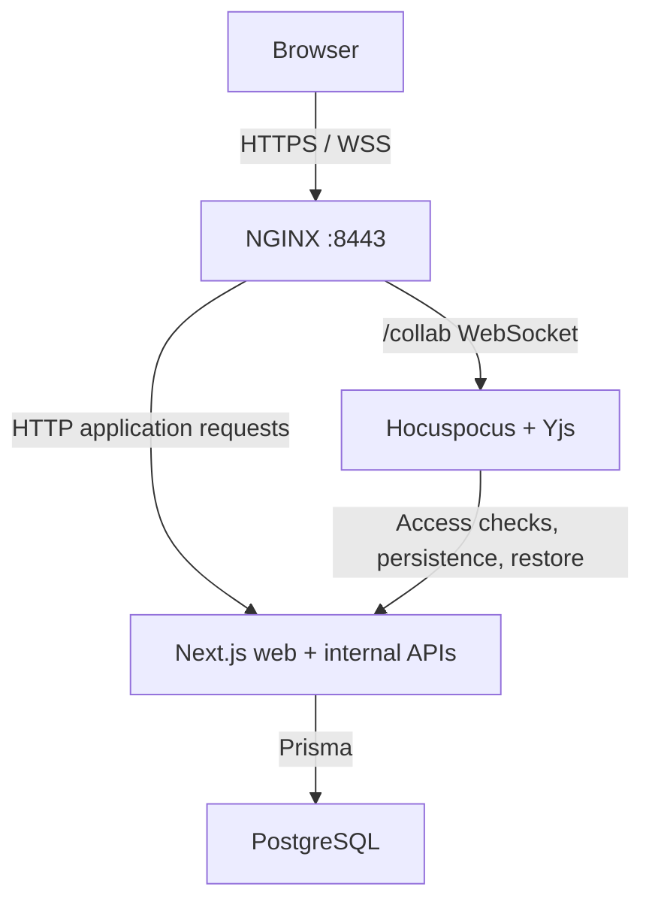
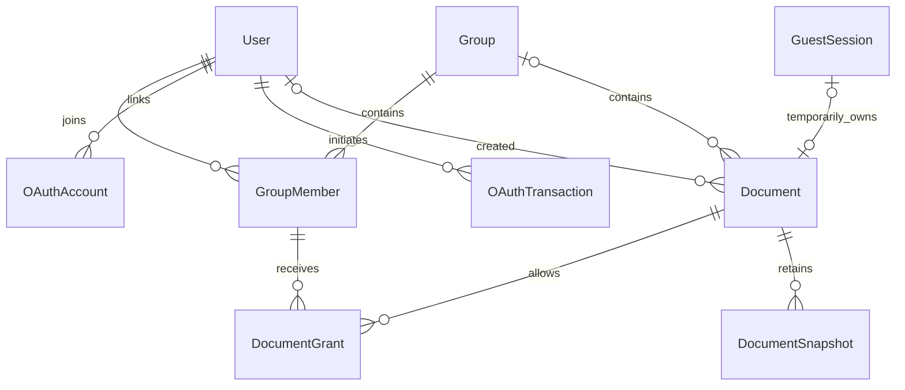

*This project has been created as part of the 42 curriculum by kmurugan, tmurua, uponci, hruiz-fr, gzanin.*

# SyncText
## Description

SyncText is a self-hosted collaborative text editor. It's a place where you can create documents and share them with others.

Organize your documents in your private space or your shared groups, where collaborators can instantly read what you write or even co-write in real time.

To try SyncText, start writing a temporary document. If you like it, just register. Your document will be saved and you'll be able to create and join other shared groups, add friends, and start co-writing.


## Instructions

### Prerequisites

- Docker
- Docker Compose v2
- GNU Make and GNU sed
- OpenSSL supporting `req -addext`
- Available ports `8443` and `8025`

Node.js 22 and npm are only required on the host for optional local development checks. The application workflow runs through Docker

### One-command deployment
1. Clone the repository.
2. Build and start all services:

   ```sh
   make
   ```

3. Open **[https://localhost:8443](https://localhost:8443)** and accept the browser's self-signed certificate warning.
4. For development email verification and password-reset messages, open **[Mailpit](http://127.0.0.1:8025)** at:
```
http://localhost:8025
```

5. You can check service health at:

```text
https://localhost:8443/status
```


### First startup

On first startup, `make`:

1. Creates `.env` from `.env.example`.

2. Generates `DB_PASSWORD` and `INTERNAL_SERVICE_TOKEN`. 
3. Creates self-signed TLS certificates in `secrets/`.
4. Builds containers, applies migrations, and starts the application.

Later runs preserve your configuration and certificates. Both `.env` and `secrets/` are ignored by Git.

### Google OAuth (optional)

Google login requires `GOOGLE_CLIENT_ID`, `GOOGLE_CLIENT_SECRET`, and a matching callback URL. See DEV.md for setup.

Without credentials, set `GOOGLE_OAUTH_ENABLED=false` in `.env`.

### Useful commands

| Command                                       | Purpose                             |
| --------------------------------------------- | ----------------------------------- |
| `make ps` / `make logs`                       | Check services / view logs          |
| `make down`                                   | Stop services without deleting data |
| `make backup-db`                              | Create database backup              |
| `make backup-db-list`                         | List backups                        |
| `make backup-db-restore BACKUP=filename.dump` | Restore a database backup           |

**Database restoration** validates the dump, stops writers, recreates the database, reapplies migrations, and restarts services.

**Warning:** `make fclean` and `make re` delete project volumes, including backups.

See [DEV.md](DEV.md) for migration and seed instructions.

### Disaster recovery procedures

The backup service creates a PostgreSQL dump when it starts, then every **24 hours** by default. It keeps the latest **seven dumps** in the `db_backups` volume. Configure this with `DB_BACKUP_INTERVAL_SECONDS` and `DB_BACKUP_RETENTION_COUNT` in `.env`.

To recover from accidental deletion or damaged application data:

1. Close all SyncText editor tabs so old browser state cannot be sent back after restoration.
2. Run `make backup-db-list` and choose a dump from before the incident.
3. Run `make backup-db-restore BACKUP=filename.dump` using that filename. This replaces the whole database; changes made after the backup are lost.
4. After a successful restore, check `make ps`, open `/status`, and verify a known document before resuming editing.

If restoration or migrations fail, application services remain stopped. Check `make logs`, fix the reported problem, and retry with a valid dump.

Backups are stored on the same Docker host. Keep an off-host copy for host or disk failure; a local backup volume alone cannot recover from that loss.

## Features List

| Feature | Functionality | Contributors |
|---|---|---|
| Accounts | Signup/login/logout, email verification/resend, password reset/change, Google linking/unlinking | Kiruthika, Gianluca, Umberto |
| Profiles and sessions | Username/avatar editing, default avatars, account deletion, hashed session tokens, expiry/revocation | Kiruthika, Gianluca, Harold |
| Friends | Send/cancel/accept/decline requests, remove friends, display recent online presence | Tom, Umberto, Gianluca |
| Documents | Create/open/rename/delete, search/sort, private spaces, editor grants | Umberto, Gianluca, Harold |
| Groups | Create/rename/delete, friend-only membership additions, roles, ownership transfer and leaving | Harold, Gianluca, Umberto |
| Guests | 30-minute editing, five-minute read-only grace period, claim on sign-in, expiry cleanup | Umberto, Harold, Kiruthika |
| Collaboration | Rich-text formatting, lists, links, find/replace, undo/redo, live cursors, reconnection, persistence | Harold, Umberto, Kiruthika, Tom |
| History | Latest five snapshots, isolated read-only previews, live restore with a recovery snapshot | Tom |
| Interface | Responsive navigation/dialogs, reusable controls, server-rendered pages, reduced-motion handling | Gianluca, Umberto, Kiruthika |
| Operations | HTTPS/WSS deployment, CI build/lint, health/status checks, scheduled backups and recovery | Tom, Harold, Umberto, Kiruthika |
| Legal pages | Footer links to Privacy Policy, Terms, Cookies and Accessibility | Kiruthika |

## Modules

**20 points: 6 Major Modules × 2 + 8 Minor Modules × 1.** 
*Evaluation requires 14 validated points.*

| Module                                 | Type/points      | Implementation and justification                                                                                                 | Contributors                              |
| -------------------------------------- | ---------------- | -------------------------------------------------------------------------------------------------------------------------------- | ----------------------------------------- |
| Frontend/backend frameworks            | Major / 2        | Next.js supplies both UI and backend routing in one application                                                                  | Umberto, all developers                   |
| WebSockets                             | Major / 2        | Push document updates/cursors with client reconnection                                                                           | Harold, Kiruthika, Tom, Umberto           |
| Standard user management               | Major / 2        | Editable profiles, uploaded/default avatars, friends and presence support collaboration                                          | Kiruthika, Umberto, Tom, Gianluca, Harold |
| Organization system                    | Major / 2        | Group CRUD, membership roles and document actions provide managed workspaces                                                     | Harold, Gianluca, Umberto                 |
| Accessibility compliance               | Major / 2        | Complete accessibility compliance (WCAG 2.1 AA) with screen reader  <br>support, keyboard navigation, and assistive technologies | Kiruthika, Gianluca                       |
| Public API                             | Major / 2        | A public API to interact with the database with a secured API key, rate  <br>limiting, documentation, and 5 endpoints            | Umberto                                   |
| ORM                                    | Minor / 1        | Prisma models, migrations and transactions maintain relational data                                                              | Harold, backend contributors              |
| Real-time collaboration                | Minor / 1        | Shared Yjs/Tiptap editing and cursors coordinate concurrent writers                                                              | Harold, Umberto, Kiruthika, Tom           |
| OAuth 2.0                              | Minor / 1        | Google OIDC provides remote login and explicit account linking                                                                   | Kiruthika                                 |
| Custom design system                   | Minor / 1        | 10+ reusable [project components](synctext/app/components) share palette, typography and icons                                   | Gianluca, Umberto                         |
| Health/backups/recovery                | Minor / 1        | Compose health checks, public `/status`, daily backups, seven-dump retention and restore workflow                                | Tom                                       |
| Additional browsers                    | Minor / 1        | Firefox, Edge and Safari extend Chrome support; team testing reports no known browser-specific limitations                       | Kiruthika, Tom, Umberto, Gianluca, Harold |
| SSR                                    | Minor / 1        | Server-rendered pages and homepage metadata provide initial HTML and SEO                                                         | Umberto, Kiruthika, Gianluca              |
| Document Version History & Restoration | Minor custom / 1 | Historical previews and recovery snapshots enable coordinated live restoration                                                   | Tom, Harold                               |

### Custom Module

The custom module lets users restore documents after accidental changes. Older versions are previewed in temporary `Y.Doc` objects, so the current document isn't affected. Since Yjs merges states, restoration needs to replace the editor content instead of merging the old state. We use database and collaboration locks to prevent conflicts between ongoing edits, saves, and restoration. Before restoring an older version, we also save the current state as a recovery snapshot. This goes beyond basic real-time editing and adds enough complexity to justify a Minor module.


## Technical Stack

| Technology                                             | Choice and purpose                                                             |
| ------------------------------------------------------ | ------------------------------------------------------------------------------ |
| Next.js 16.3.1, React 19.2.8, TypeScript 5.9.3         | Frontend pages and backend API handlers share typed application code           |
| Tiptap 3.30.2                                          | Extensible rich-text editing                                                   |
| Yjs 13.6.32, Hocuspocus 4.6.0                          | Concurrent document state, WebSocket synchronization and cursors               |
| PostgreSQL 16, Prisma 7.9.1                            | Relational integrity, transactions, binary state, typed queries and migrations |
| Tailwind CSS 4.3.3, shadcn/Base UI, custom CSS, Lucide | Shared styling, interactive primitives and icons                               |
| Argon2id, Zod, zxcvbn, oauth4webapi                    | Salted password hashing, input validation, strength checks and Google OIDC     |
| Node.js 22, Docker Compose, NGINX, Mailpit             | Reproducible runtime, HTTPS routing and local email inspection                 |

### Architecture



The collaboration service uses authenticated internal Next.js endpoints for access checks, persistence, and restore coordination. It does not connect directly to PostgreSQL. Browser traffic uses HTTPS/WSS through NGINX, while service-to-service traffic stays inside the Docker Compose networks.

| Service | Responsibility |
|---|---|
| `nginx` | TLS termination and routing to the web and collaboration services |
| `web` | UI, authentication, document APIs, permissions, and database access |
| `collab` | Live Yjs documents, connection authorization, persistence, and restore coordination |
| `db` | PostgreSQL storage |
| `migrate` | Applies Prisma migrations before the web service starts |
| `mailpit` | Captures local development email |
| `cleanup` | Periodically removes expired guest sessions, auth tokens and abandoned signups |
| `backup` | Automatically backs up PostgreSQL and provides database restoration |

The repository uses npm workspaces:

- `synctext/` for the Next.js application;
- `services/collab/` for the collaboration service;
- `packages/db/` for Prisma and database helpers;
- `packages/shared/` for shared types and constants.

## Database Schema

The database schema is defined in `packages/db/prisma/schema.prisma`. SQL migrations enforce additional constraints where Prisma's schema language is not sufficient.




| Model                                          | Key fields/types                                                                          | Relationships                                                     |
| ---------------------------------------------- | ----------------------------------------------------------------------------------------- | ----------------------------------------------------------------- |
| `User`                                         | Unique `email, username: String`, `passwordHash/avatarUrl: String?`, `role: PlatformRole` | Memberships, sessions, tokens, OAuth identities, friendship pairs |
| `Group`                                        | `name: String`, `isPrivateSpace: Boolean`                                                 | Many memberships/documents                                        |
| `GroupMember`                                  | `role: GroupRole`; unique `groupId/userId`                                                | Joins user/group; holds grants                                    |
| `Document`                                     | `title: String`, `ystate: Bytes?`, nullable `groupId/guestSessionId/createdById`          | Group or guest holder; snapshots/grants                           |
| `DocumentGrant`                                | Composite `membershipId/documentId` key                                                   | Grants one membership editor access                               |
| `DocumentSnapshot`                             | `ystate: Bytes`, `createdAt: DateTime`                                                    | Historical state for one document                                 |
| `GuestSession`                                 | Unique `tokenHash: String`, `editExpiresAt/expiresAt`                                     | At most one temporary document                                    |
| `Friendship`                                   | Composite `userAId/userBId`, `requestedById`, `status: FriendshipStatus`                  | Two users; canonical ordered pair                                 |
| `Session`                                      | Unique `tokenHash: String`, `expiresAt`, nullable `revokedAt/lastUsedAt`                  | One authenticated user                                            |
| `OAuthAccount`                                 | `provider/providerAccountId: String`; unique pair                                         | One linked user                                                   |
| `OAuthTransaction`                             | `stateHash/codeVerifier/nonce: String`, `purpose: OAuthPurpose`, `expiresAt`              | Optional initiating user                                          |
| `EmailVerificationToken`, `PasswordResetToken` | Unique `tokenHash: String`, `expiresAt`, nullable `usedAt`                                | One user per token                                                |

Main enums:

- `PlatformRole`: `USER`, `ADMIN`
- `GroupRole`: `OWNER`, `ADMIN`, `MEMBER`
- `FriendshipStatus`: `PENDING`, `ACCEPTED`, `DECLINED`
- `OAuthPurpose`: `SIGN_IN`, `LINK`

### Document access model

For documents belonging to a group:

- every group member can view the group's documents;
- the group `OWNER` can edit, rename, and delete them;
- other members require a `DocumentGrant` for edit-level actions;
- creating a document gives its creator a grant through their membership;
- `createdById` records who created the document but does not itself grant access;
- a non-member receives `404`, while a member attempting a forbidden write receives `403`;
- the platform `ADMIN` role does not bypass document permissions.

The same permission model is used by document APIs and collaboration access checks.

## Team Information

All five members are developers; additional roles define coordination responsibilities.

| Member / 42 login | Role | Responsibility |
|---|---|---|
| Kiruthika Murugananthan / `kmurugan` | Product Owner | Product priorities, authentication/security |
| Tom Murua / `tmurua` | Project Manager / Scrum Master | Coordination, infrastructure, documentation |
| Umberto Ponci / `uponci` | Technical Lead / Architect | Technical direction, integration, quality |
| Harold Ruiz-Franck / `hruiz-fr` | Developer | Database, collaboration, permissions |
| Gianluca Zanin / `gzanin` | Developer | Frontend, components, responsive UI |

## Project Management

The team uses GitHub Issues to organize and assign tasks, and feature branches and pull requests for development. Each PR requires at least two reviews before merging. Responsibilities are divided between team members, but integration and testing are shared.

The team meets weekly, every Wednesday through Google Meet, with some team members joining in person whenever possible. We also keep in touch almost daily through our WhatsApp group.

CI is used to build the Docker Compose stack and run lint checks.

## Individual Contributions

- **Kiruthika (`kmurugan`):** implemented registration, verification/reset emails, password/session security, OAuth, legal pages and validation tooling. Collaboration access rechecks address sessions or permissions changing while a WebSocket remains connected.
- **Tom (`tmurua`):** implemented Compose/HTTPS infrastructure, Friends API, persistence, snapshots, history/preview, restore, status and database backups; coordinates integration and documentation. Serialized writes, restore locks and recovery snapshots address concurrent edits during restoration.
- **Umberto (`uponci`):** integrated the editor/application, document/dashboard APIs, guest documents and CI; contributed navigation and authentication UI. Transactional guest claiming transfers the document before deleting its temporary session, preserving content.
- **Harold (`hruiz-fr`):** implemented Prisma workspaces/schema/migrations/fixtures, Hocuspocus/Yjs infrastructure, viewer behavior, synchronization fixes, groups and centralized permissions. Membership grants keep access independent of the original creator and revoke it when members leave.
- **Gianluca (`gzanin`):** implemented authentication/dashboard/profile layouts, friends/group UI, menus, document actions, reusable components and mobile controls. Truncation/tooltips and responsive navigation keep long titles and dense controls usable on smaller screens.

## Resources

- Web: [Next.js](https://nextjs.org/docs), [React](https://react.dev/learn), [TypeScript](https://www.typescriptlang.org/docs/).
- Editing: [Tiptap](https://tiptap.dev/docs/editor/getting-started/overview), [Yjs](https://docs.yjs.dev/), [Hocuspocus](https://tiptap.dev/docs/hocuspocus/getting-started/overview).
- Collaboration and document history: [Yjs Awareness & Presence](https://docs.yjs.dev/getting-started/adding-awareness), [Yjs Document Updates](https://docs.yjs.dev/api/document-updates), [Yjs Y.XmlFragment](https://docs.yjs.dev/api/shared-types/y.xmlfragment), [Hocuspocus Persistence](https://tiptap.dev/docs/hocuspocus/guides/persistence), [Tiptap CollaborationCaret](https://tiptap.dev/docs/editor/extensions/functionality/collaboration-caret).
- Data/deployment: [Prisma](https://www.prisma.io/docs), [PostgreSQL 16](https://www.postgresql.org/docs/16/), [Docker Compose](https://docs.docker.com/compose/), [NGINX WebSockets](https://nginx.org/en/docs/http/websocket.html), [Mailpit](https://mailpit.axllent.org/docs/).
- Database concurrency and recovery: [PostgreSQL Row-Level Locks](https://www.postgresql.org/docs/16/explicit-locking.html#LOCKING-ROWS), [PostgreSQL SQL Dumps and Restoration](https://www.postgresql.org/docs/16/backup-dump.html).
- Container startup: [Docker Compose Startup Order](https://docs.docker.com/compose/how-tos/startup-order/).
- UI/security: [shadcn/ui](https://ui.shadcn.com/docs), [Base UI](https://base-ui.com/react/overview/quick-start), [OWASP password storage](https://cheatsheetseries.owasp.org/cheatsheets/Password_Storage_Cheat_Sheet.html).
- Authentication: [The Copenhagen Book](https://thecopenhagenbook.com/), [OWASP Cheat Sheet Series](https://cheatsheetseries.owasp.org/cheatsheets) ([Authentication](https://cheatsheetseries.owasp.org/cheatsheets/Authentication_Cheat_Sheet.html), [Content Security Policy](https://cheatsheetseries.owasp.org/cheatsheets/Content_Security_Policy_Cheat_Sheet.html), [OAuth2](https://cheatsheetseries.owasp.org/cheatsheets/OAuth2_Cheat_Sheet.html)), [zxcvbn docs](https://zxcvbn-ts.github.io/zxcvbn/guide/getting-started/).
- Sessions: [Sessions vs tokens](https://dev.to/jps27cse/sessions-vs-tokens-complete-guide-for-backend-engineers-2gdk), [Session management: JWTs vs opaque tokens](https://guptadeepak.com/ciam-compass/guides/session-management-jwts-vs-opaque-tokens/).
- OAuth 2.0: [DeepWiki oauth4webapi](https://deepwiki.com/panva/oauth4webapi), [Account linking by email match trusts a claim, not a verification](https://safeguard.sh/resources/blog/account-linking-trusts-a-claim-not-a-verification), [Google OpenID configuration](https://accounts.google.com/.well-known/openid-configuration), [Google OAuth 2.0 web-server flow](https://developers.google.com/identity/protocols/oauth2/web-server).
- Email: [Verification email examples](https://flodesk.com/tips/verification-email-examples).
- Collaboration authentication: [Hocuspocus hooks](https://tiptap.dev/docs/hocuspocus/server/hooks), [Hocuspocus authentication](https://tiptap.dev/docs/hocuspocus/guides/authentication).
- Content Security Policy: [CSP reference](https://content-security-policy.com/), [CSP explained](https://www.youtube.com/watch?v=ET3o4EtDqL8).
- Accessibility: [Accessibility Developer Guide](https://www.accessibility-developer-guide.com/).

### AI Usage

AI tools are used to help us learn unfamiliar concepts, like understanding how Yjs synchronization works. AI also helps by providing test cases for simultaneous editing and reconnections, investigating bugs, and reviewing documentation against the 42 requirements.

AI output is always treated as suggestion, and never as solution. All changes in the project are reviewed through code review, type checking, linting, and manual testing.