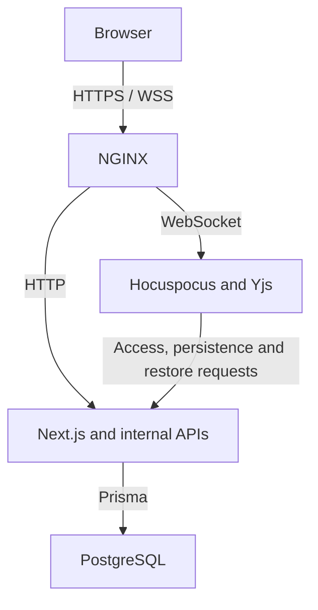

*Created as part of the 42 curriculum by kmurugan, tmurua, uponci, hruiz-fr and gzanin.*

# SyncText

A self-hosted collaborative text editor with live co-editing, document version previews and restoration. Built by a five-person team at 42 Berlin.


## This repository

This is Tom Murua's portfolio copy, published with the team's permission. The original project is [ArchCipher/42-ft_transcendence](https://github.com/ArchCipher/42-ft_transcendence), which is currently private. Team authorship and development history are retained.

## My contribution

I worked as a developer and Project Manager. My main contributions were:

- Document persistence and the snapshots/history module, including read-only previews, restoration and a recovery snapshot before restoring.
- Docker Compose and HTTPS deployment, service health/status checks, and scheduled PostgreSQL backup and restore scripts.
- Integration and documentation coordination, GitHub Issues, task responsibilities and weekly team meetings.
- Contributions to the Friends API and collaboration/persistence integration.

These were team projects and shared integration work. The original [individual contribution breakdown](README.42.md#individual-contributions) records the other developers' work and shared responsibilities.

## Run locally

Requirements: Docker, Docker Compose v2, GNU Make, GNU sed and OpenSSL with `req -addext` support. Ports 8443 and 8025 must be available.

```sh
git clone https://github.com/tmurua/synctext.git
cd synctext
make
```

Open https://localhost:8443 and accept the local self-signed certificate. Development email is captured by Mailpit at http://localhost:8025. Service health is available at https://localhost:8443/status.

The first startup creates `.env` from `.env.example`, generates database/internal-service credentials and TLS certificates, applies database migrations, and starts the services. Generated `.env` and `secrets/` files are ignored by Git.

Google sign-in is optional. Without OAuth credentials, set `GOOGLE_OAUTH_ENABLED=false` in `.env`. See [DEV.md](DEV.md) for development and OAuth configuration.

## Architecture



The collaboration service calls internal web APIs for authorization, persistence and restoration. It does not access PostgreSQL directly.

Stack: TypeScript, Next.js/React, Tiptap, Yjs/Hocuspocus, Prisma, PostgreSQL, Docker Compose and NGINX.

## Versions and recovery

Document history keeps the latest five snapshots. Previews use isolated Yjs documents. Restoration coordinates database and collaboration locks and saves the current state as a recovery snapshot.

Database backups are separate from document history. The backup service runs on startup and every 24 hours by default, retaining seven dumps.

```sh
make backup-db
make backup-db-list
make backup-db-restore BACKUP=filename.dump
```

Before a database restore, close editor tabs. The restore replaces the entire database, so changes after the chosen backup are lost. Backups are on the same Docker host; host or disk loss requires an off-host copy. `make fclean` and `make re` delete project volumes, including backups.

## Team and documentation

- Kiruthika Murugananthan (`kmurugan`)
- Tom Murua (`tmurua`)
- Umberto Ponci (`uponci`)
- Harold Ruiz-Franck (`hruiz-fr`)
- Gianluca Zanin (`gzanin`)

The [original development and evaluation documentation](README.42.md) preserves feature credits, module mapping, resources, AI-use disclosures and the detailed project explanation. [DEV.md](DEV.md) covers development workflows.
